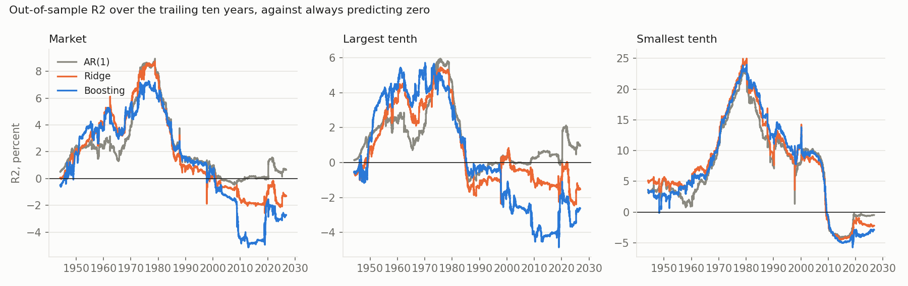

# Can machine learning predict tomorrow's stock return from past prices?

[](https://github.com/rxj0102/Stock-Return-Prediction/actions/workflows/ci.yml)

**Question.** The most common first project in quantitative finance trains a model on past prices to predict the next day. Does it work, did it ever, and does a flexible model find anything a one-line regression does not?

<!-- headline:start (generated by scripts/render_readme.py, do not edit by hand) -->
**Answer, from 23,568 out-of-sample daily forecasts between 1935 and 2026: it could until the late 1990s, and a one-variable regression did it as well as machine learning. Since 2000 it cannot.** From 1970 to 1999 a regression on yesterday's return explains 3.1% of next-day market variance out of sample, and gradient boosting with 17 features explains 2.5%. Since 2000 boosting is worse than always predicting zero in both later eras (R2 as low as -4.0%), and over the full sample it is significantly less accurate than the one-variable regression (t = 3.6). On the market no model beats buy and hold after 5 bps costs in either era since 2000. The old predictability was strongest where prices were stalest: 14% for the smallest stocks from 1970 to 1999, which is a sign of prices that had not yet traded, not of money left on the table.
<!-- headline:end -->

Every number on this page is written by `scripts/reproduce.py`, and CI reruns the study and fails if the page and the results disagree.



## Results

<!-- results:start (generated by scripts/render_readme.py, do not edit by hand) -->
Forecasts 1935-10-24 to 2026-09-29 (94 years). Each model is trained on the latest 2,520 days and refitted every 252 days, 94 times per series.

### Accuracy

Out-of-sample R2 against always predicting zero, with the Clark-West t-statistic in brackets (above 1.65 is significant at 5%, one sided). Autocorrelation is the plain correlation of each day's return with the day before.

**Market**

| Era | Days | Autocorrelation | AR(1) | Ridge | Boosting |
|---|---|---|---|---|---|
| 1935-1969 | 9,261 | +0.12 | +1.64% (+10.6) | +1.92% (+9.1) | +1.82% (+8.8) |
| 1970-1999 | 7,582 | +0.16 | +3.14% (+10.1) | +2.58% (+9.0) | +2.55% (+11.9) |
| 2000-2012 | 3,269 | -0.06 | -0.09% (+0.8) | -1.59% (-0.5) | -4.00% (-0.7) |
| 2013-2026 | 3,456 | -0.11 | +0.50% (+2.1) | -1.28% (+2.2) | -2.48% (+0.4) |
| All | 23,568 | +0.04 | +1.36% (+11.8) | +0.55% (+10.1) | -0.36% (+9.1) |

**Largest tenth**

| Era | Days | Autocorrelation | AR(1) | Ridge | Boosting |
|---|---|---|---|---|---|
| 1935-1969 | 9,261 | +0.10 | +1.17% (+9.1) | +1.15% (+7.7) | +1.98% (+9.3) |
| 1970-1999 | 7,582 | +0.08 | +1.09% (+7.5) | +0.61% (+6.8) | +0.17% (+7.7) |
| 2000-2012 | 3,269 | -0.09 | +0.27% (+1.9) | -1.24% (+0.6) | -3.79% (-0.2) |
| 2013-2026 | 3,456 | -0.13 | +0.71% (+2.2) | -1.49% (+2.4) | -2.54% (+0.9) |
| All | 23,568 | +0.01 | +0.84% (+8.6) | -0.09% (+8.2) | -0.84% (+7.8) |

**Smallest tenth**

| Era | Days | Autocorrelation | AR(1) | Ridge | Boosting |
|---|---|---|---|---|---|
| 1935-1969 | 9,261 | +0.20 | +4.02% (+5.4) | +5.76% (+5.0) | +4.30% (+6.4) |
| 1970-1999 | 7,582 | +0.38 | +14.33% (+11.5) | +15.99% (+14.4) | +16.65% (+17.7) |
| 2000-2012 | 3,269 | +0.06 | -0.78% (+3.0) | -1.62% (+2.9) | -1.73% (+3.7) |
| 2013-2026 | 3,456 | -0.02 | -0.39% (-1.6) | -1.93% (-0.1) | -2.75% (+0.3) |
| All | 23,568 | +0.16 | +3.66% (+9.9) | +4.32% (+8.4) | +3.48% (+11.4) |

**When it went away.** Trailing ten year R2 of the AR(1) forecast, as in the figure

| Series | Peak | Ten years ending | First below zero |
|---|---|---|---|
| Market | 8.9% | 1978 | 1997 |
| Largest tenth | 5.9% | 1975 | 1984 |
| Smallest tenth | 23.6% | 1978 | 2009 |

### Does machine learning add anything to one lag?

Diebold-Mariano t-statistic of squared error against the AR(1) forecast. Negative means more accurate than AR(1), positive less; beyond 1.96 either way is significant.

| Series | Model | 1935-1969 | 1970-1999 | 2000-2012 | 2013-2026 | All |
|---|---|---|---|---|---|---|
| Market | Ridge | -0.6 | +1.7 | +2.4 | +1.9 | +2.8 |
| Market | Boosting | -0.2 | +1.1 | +3.8 | +1.9 | +3.6 |
| Largest tenth | Ridge | +0.0 | +1.3 | +2.2 | +2.1 | +3.1 |
| Largest tenth | Boosting | -1.2 | +1.8 | +3.8 | +2.0 | +3.6 |
| Smallest tenth | Ridge | -2.0 | -2.6 | +1.0 | +2.4 | -1.4 |
| Smallest tenth | Boosting | -0.3 | -1.9 | +0.7 | +2.9 | +0.3 |

### Trading it

Hold the series when the forecast is positive, cash otherwise, 5 bps per unit traded. Each cell is the strategy's Sharpe ratio minus buy and hold's, with a 95% bootstrap interval. The last column is the cost at which the full-sample edge over buy and hold disappears.

| Series | Model | 1935-1969 | 1970-1999 | 2000-2012 | 2013-2026 | Break-even cost, all years |
|---|---|---|---|---|---|---|
| Market | AR(1) | +0.46 [+0.25, +0.69] | +0.91 [+0.62, +1.20] | -0.26 [-0.53, +0.04] | -0.24 [-0.64, +0.11] | 9 bps |
| Market | Boosting | +0.74 [+0.46, +1.05] | +0.74 [+0.43, +1.03] | -0.52 [-0.84, -0.23] | -0.47 [-0.76, -0.22] | 8 bps |
| Largest tenth | AR(1) | +0.36 [+0.15, +0.56] | +0.34 [+0.11, +0.55] | +0.01 [-0.26, +0.26] | -0.25 [-0.65, +0.10] | 8 bps |
| Largest tenth | Boosting | +0.64 [+0.39, +0.91] | +0.10 [-0.12, +0.31] | -0.54 [-0.86, -0.24] | -0.49 [-0.81, -0.22] | 5 bps |
| Smallest tenth | AR(1) | +0.62 [+0.38, +0.91] | +2.86 [+2.45, +3.24] | +0.73 [+0.21, +1.23] | -0.31 [-0.48, -0.16] | 18 bps |
| Smallest tenth | Boosting | +1.01 [+0.70, +1.38] | +3.24 [+2.78, +3.67] | +0.53 [+0.02, +1.02] | -0.16 [-0.51, +0.20] | 23 bps |

Buy and hold Sharpe ratio of the market by era: 0.70 (1935-1969), 0.51 (1970-1999), 0.12 (2000-2012), 0.78 (2013-2026). The strategies trade about 89 times a year.
<!-- results:end -->

### Break dates set by regulation

The four eras above were chosen after looking at the data. As a check that does not depend on that choice, the same forecasts are split at the two dates the NYSE cut its minimum tick: from eighths of a dollar to sixteenths on 24 June 1997, and to pennies on 29 January 2001 (Nasdaq followed in April 2001). Forecasts from 1970.

<!-- ticks:start (generated by scripts/render_readme.py, do not edit by hand) -->
| Series | Eighths (6,945 days) | Sixteenths (907 days) | Decimals (6,455 days) |
|---|---|---|---|
| Market, autocorrelation | +0.19 | +0.01 | -0.09 |
| Market, AR(1) R2 (Clark-West t) | +3.75% (+10.1) | -0.54% (+0.6) | +0.21% (+2.3) |
| Largest tenth, autocorrelation | +0.10 | -0.02 | -0.11 |
| Largest tenth, AR(1) R2 (Clark-West t) | +1.23% (+7.5) | -0.04% (+0.5) | +0.51% (+2.8) |
| Smallest tenth, autocorrelation | +0.39 | +0.34 | -0.01 |
| Smallest tenth, AR(1) R2 (Clark-West t) | +15.07% (+11.0) | +11.30% (+4.0) | -1.53% (+1.2) |

The market's day-to-day autocorrelation was +0.19 under eighths, +0.01 under sixteenths and -0.09 under pennies. For the market and the largest stocks the momentum-like predictability is gone by the sixteenths, a short period (907 days) and so a noisy one; under pennies a small reversal takes its place (R2 0.21% on the market). The smallest stocks keep it through the sixteenths (R2 11%) and lose it with decimals (-1.5%). The order matches Chordia, Roll and Subrahmanyam (2008), who find that short-horizon predictability fell with each cut in the minimum tick, and it matches the stale-price reading: the smallest stocks, whose prices update last, are the last to lose it.
<!-- ticks:end -->

## Reading the results

- **The sign of the autocorrelation flipped.** Until the 1990s a good day for the market tended to be followed by another. Since 2000 it has tended to be followed by a slightly worse one. A model trained on ten years of the old pattern has nothing to carry into the new one.
- **Complexity did not buy accuracy.** On the market, boosting is never significantly more accurate than one lag in any era, and over the full sample it is significantly worse. Seventeen features were mostly rediscovering yesterday's return. The exception is the smallest stocks before 2000, where ridge helps, and that is the series with the least trustworthy prices.
- **The old predictability was largely not tradable.** A portfolio return is an average of last trade prices. When many stocks do not trade every day, yesterday's news shows up in today's index return, and the index looks predictable although no stock was. That is why the effect grows as stocks get smaller and why it faded as trading became continuous. It also left in order of liquidity: the largest stocks first, then the market, the smallest stocks last.
- **The backtest flatters the past.** The table charges 5 bps per trade in every era. That is generous today and far below what trading cost when commissions were fixed and prices moved in eighths of a dollar. The break-even costs are the honest number: under 10 bps for the market, well below what a round trip cost for most of the last century.
- **A little reversal remains.** In the latest era the one-lag regression still has a small positive R2 on the market and on large stocks. Its edge is gone after costs.
- **Direction accuracy is a poor score.** The market rises on more than half of all days, so always guessing up beats a coin. The study scores forecasts on squared error against a zero forecast and on a strategy against buy and hold.

## Design

| Choice | What and why |
|---|---|
| Data | Daily excess returns of the US market, the largest tenth of stocks and the smallest tenth, July 1926 to September 2026, from the Ken French Data Library. |
| Target | The next day's excess return. |
| Features | 17, all from the series' own past returns: five lags, four trailing means, three trailing volatilities, the absolute return, drawdown from the one-year high, days since the last session, and the lengths of the current up and down runs. |
| Training | Rolling ten years, refitted once a year. A model only ever sees returns that were realised before the day it forecasts. |
| Models | Zero, trailing mean, AR(1), ridge, gradient boosted trees. The trailing mean is in `results/metrics.json` and is left out of the tables to keep them short. |
| Tuning | None. Penalty, tree depth, number of trees and learning rate were fixed before the first run, and the first run is the one reported. No feature selection, no model picked on test data. |
| Scoring | Out-of-sample R2 against zero with the Clark-West test, squared error against AR(1) with the Diebold-Mariano test, and a long or cash strategy against buy and hold with a block bootstrap. |

The four eras were set before any model was run, but after looking at raw autocorrelations by period, so the break at 2000 is partly chosen with knowledge of the data. The figure, the table of dates and the split at the regulatory tick-size dates do not depend on the era boundaries and show the same thing. The tick-size split was added after the first results, following a literature review.

## What was wrong with the first version

It predicted one stock (AAPL) over one 500 day test window with 17 models and reported the best. With 500 days the standard error of a direction accuracy is about 2 points, so the best model's 53% was noise, and it was the maximum of 17 tries. The backtest model was chosen on the window it was tested on. The data came from Yahoo, the results lived in a notebook, and a random search made every rerun different. Nothing could be concluded.

The rebuild asks the same question on a century of data, fixes every setting in advance, and compares against the simplest model that could explain the result.

## Limits

- Portfolio returns, not single stocks, and no volume or intraday data. Single stocks have more noise and less of the stale-price effect; nothing here says a richer feature set on other data would fail. The machine learning gains documented by Gu, Kelly and Xiu (2020) are in the cross-section of monthly stock returns with many firm characteristics, a different problem from forecasting one index from its own past; this study says nothing about that one.
- The strategy trades at the same close that produces the signal. With stale prices that trade did not exist, which is the point made above.
- One training window (ten years) and one refit schedule. Others were not tried, on purpose.
- Twelve series and era combinations with three models each are reported. The claims on this page rest on the pattern across them, not on any single cell.

## Reproduce

```bash
pip install -r requirements.txt
python -m pytest -q               # tests
python scripts/reproduce.py       # about a minute, rewrites results/
python scripts/render_readme.py   # rewrites this page; --check compares only
```

Returns are frozen in `data/snapshot/daily_excess_returns.csv.gz`. `python -m src.data` downloads them again.

## Layout

```
src/data.py      Ken French loader and the frozen snapshot
src/study.py     features, models, the walk-forward loop, tests and the strategy
scripts/         reproduce.py writes results/, render_readme.py writes this page
tests/           look-ahead, feature, model and accounting checks
```

## References

- Chordia, T., Roll, R. and Subrahmanyam, A. (2008). Liquidity and market efficiency. *Journal of Financial Economics* 87(2).
- Clark, T. and West, K. (2007). Approximately normal tests for equal predictive accuracy in nested models. *Journal of Econometrics* 138(1).
- Diebold, F. and Mariano, R. (1995). Comparing predictive accuracy. *Journal of Business and Economic Statistics* 13(3).
- Gu, S., Kelly, B. and Xiu, D. (2020). Empirical asset pricing via machine learning. *Review of Financial Studies* 33(5).
- Lo, A. and MacKinlay, A. C. (1990). An econometric analysis of nonsynchronous trading. *Journal of Econometrics* 45(1).
- Welch, I. and Goyal, A. (2008). A comprehensive look at the empirical performance of equity premium prediction. *Review of Financial Studies* 21(4).
